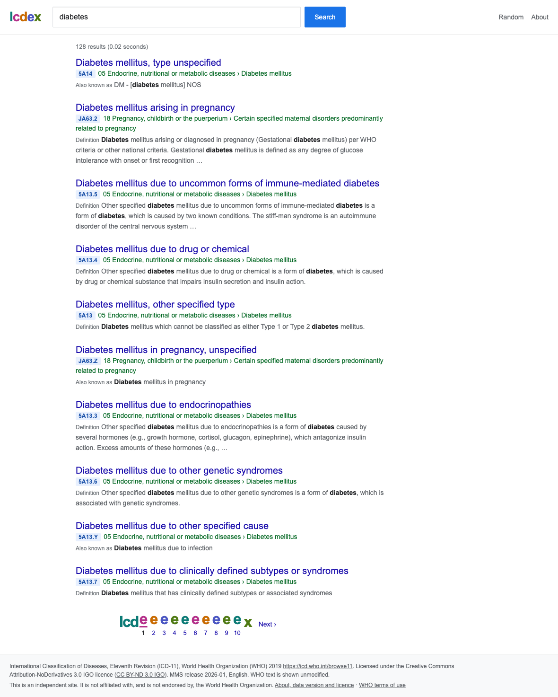

# icd-search ("Icdex")

Static, client-side search for the WHO ICD-11 MMS classification, for https://icd.francoisvw.com.
The server only serves files. On the first visit the browser downloads the dataset once, verifies it, stores it in
IndexedDB and builds a search index; after that everything runs locally, offline-capable, with no third-party requests.



* **Search** in Rust compiled to WebAssembly, inside a Web Worker: BM25F ranking over titles, index terms, inclusions and
  definitions; exact and partial code match first (`8B88`, `8b88.0`); prefixes, typo tolerance, highlighted snippets, typeahead.
* **Code pages** with WHO's text verbatim, related codes (parent, children, siblings, exclusions, coded elsewhere, see also),
  hover/focus preview cards, a breadcrumb, a link to the WHO browser and an anatomy diagram for anatomical references.
* **Graph view** (`/graph/<code>`): force layout around a code, click to re-centre, expand on demand.
* **Deep links** that work on a static host: `/code/8B88.0`, `/search?q=heart&p=2`, `/graph/BA00`.
* Mobile friendly, keyboard accessible, light and dark, strict CSP, storage-quota check, About page with data version and
  "clear local data".

More screenshots: [`docs/screenshots/`](docs/screenshots).

## Build and test

Prerequisites: Rust stable with the `wasm32-unknown-unknown` target, `wasm-bindgen-cli` at the version in `Cargo.lock`
(`cargo install wasm-bindgen-cli --version <that version> --locked`), Node ≥ 22.

```sh
make build        # everything, from the committed dataset in data/ → ./dist  (≈ 20 s)
make test         # cargo test (ranking on the real dataset) + Playwright e2e against ./dist
make serve        # http://127.0.0.1:4173 with the production headers
make image        # runtime image, see docs/DEPLOY.md
```

First run of the e2e suite: `cd web && npx playwright install chromium`. Playwright can also target any running server,
for example the container: `E2E_BASE_URL=http://127.0.0.1:8080 npx playwright test`.
`make build` runs, in order: WASM build, dataset shards + manifest (`web/scripts/build-data.mjs`), type check, Vite
build, brotli/gzip precompression, server config (`web/scripts/sws-config.mjs`). CI (`.github/workflows/ci.yml`) runs
the same commands, then the e2e suite against the built site and again against the container image.

## Layout

| Path | What |
|---|---|
| `tools/extract/` | extractor: walks the whole MMS linearization of a local WHO ICD-API container → `data/` ([README](tools/extract/README.md)) |
| `data/icd11-mms-2026-01/` | committed extractor output: `dataset.json` + 8 NDJSON shards (18 MB, 37,211 entities) |
| `crates/icd-search/` | search engine (index build, ranking, snippets, code pages' neighbour model) + `wasm.rs` bindings; tests in `tests/ranking.rs` |
| `web/` | the app (vanilla TypeScript, Vite), worker, e2e tests, build scripts |
| `tools/anatomy/` | generator of the CC0 body diagrams ([docs/ANATOMY.md](docs/ANATOMY.md)) |
| `docker/` | runtime image and server config ([docs/DEPLOY.md](docs/DEPLOY.md)) |
| `scripts/bench-index.mjs` | measurement behind the index decision below |

## Numbers (release 2026-01)

| | |
|---|---|
| First-visit download | **≈ 2.3 MB** over the wire with brotli (dataset 2.18 MB + app 0.11 MB: WASM 85 KB, JS 19 KB, CSS 4 KB); ≈ 3.1 MB with gzip. Raw dataset 18.0 MB |
| Stored in the browser | dataset 18.0 MB + serialized index 4.7 MB in IndexedDB |
| First-visit setup | 1.4 s on a fast desktop and a fast link; **≈ 4.7 s** with 9 Mbps / 150 ms RTT; **≈ 18 s** at 1.6 Mbps / 300 ms. Index build ≈ 0.6 s on a desktop (see below for a phone). `web/scripts/measure-setup.mjs` reproduces this |
| Later visits | no dataset download; the index loads in ≈ 35 ms; a search takes ≈ 3 ms |
| Container | 30 MB image, ≈ 20 MB RAM |

**Setup on a mid-range phone** (not measured on hardware): the network part is the numbers above. The CPU-bound parts
(verify, store, index build) take ≈ 0.7 s here; scaled 4–6× for a mid-range phone that is ≈ 3–4 s, so about 7–9 s on 4G
and about 21–23 s on a slow 4G link. Chromium's CPU throttling does not reach Web Workers, so this scaling is an estimate.

## Index: built at build time or in the browser?

Measured (`scripts/bench-index.mjs`, Node + the same WASM, Apple Silicon): building the index from the shards takes
≈ 520 ms in WASM; the serialized index is 4.70 MB raw, **2.17 MB** brotli (2.34 MB gzip), against 2.35 MB for the dataset
itself. Shipping it prebuilt would roughly double the first download to save about half a second of CPU, so the browser
**builds the index during setup and stores it in IndexedDB**; later visits load the stored index (≈ 33 ms). The index is
tied to the dataset id, so a new release rebuilds it.

## Licences

| | |
|---|---|
| Site source code | **MIT**, © 2026 takenagain ([`LICENSE`](LICENSE)) |
| ICD-11 data (`data/` and everything built from it) | © WHO, shown unmodified under **CC BY-ND 3.0 IGO**. **Not covered by the MIT licence** |
| Anatomy diagrams | **CC0 1.0** |

[docs/LICENSING.md](docs/LICENSING.md) explains how the site complies with WHO's terms and what to watch (name,
redistribution, mappings). This site is independent and not endorsed by WHO.
